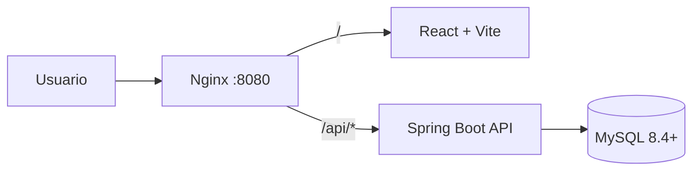

# SIGAC — Sistema Integrado de Gestión Académica

<p align="center">
  
</p>

<p align="center">
  Plataforma web para centralizar y automatizar la gestión académica de la<br>
  <strong>Asociación Cultural de Santa Bárbara de Heredia (ACUSAB)</strong>.
</p>

> [!NOTE]
> SIGAC es un proyecto académico en desarrollo de estudiantes de Ingeniería en Sistemas de la Universidad Nacional de Costa Rica. El repositorio no representa todavía una versión final para producción.

## Contenido

- [Acerca del proyecto](#acerca-del-proyecto)
- [Alcance funcional](#alcance-funcional)
- [Estado actual](#estado-actual)
- [Arquitectura](#arquitectura)
- [Tecnologías](#tecnologías)
- [Estructura del repositorio](#estructura-del-repositorio)
- [Instalación local](#instalación-local)
- [Variables de entorno](#variables-de-entorno)
- [API disponible](#api-disponible)
- [Pruebas y calidad](#pruebas-y-calidad)
- [Despliegue](#despliegue)
- [Flujo de trabajo](#flujo-de-trabajo)
- [Seguridad](#seguridad)
- [Licencia](#licencia)

## Acerca del proyecto

SIGAC nace para reemplazar procesos académicos administrados mediante hojas de cálculo y documentos aislados. Su objetivo es ofrecer una única fuente de información, mejorar la trazabilidad de los cambios y facilitar el trabajo del personal administrativo, docentes y estudiantes de ACUSAB.

El sistema se diseña para gestionar el ciclo académico completo: personas, programas, cursos, matrícula, evaluación, asistencia, becas, mensualidades y reportes. Los pagos no se procesan dentro de SIGAC; únicamente se registran comprobantes y confirmaciones administrativas.

## Alcance funcional

El modelo de datos contempla los siguientes módulos:

- Usuarios, roles, estados de cuenta y autenticación.
- Estudiantes, profesores, encargados e instrumentos estudiados.
- Programas académicos, planes de estudio, cursos, niveles y prerrequisitos.
- Periodos lectivos, grupos, autorización previa y matrícula.
- Calificaciones, asistencia, equiparaciones y seguimiento académico.
- Becas, documentos, comprobantes y confirmación de mensualidades.
- Alertas, reportes y bitácora automática mediante triggers.

Fuera del alcance:

- Procesamiento de pagos en línea.
- Inventario, préstamo o mantenimiento de instrumentos.
- Gestión de bodega, activos y patrimonio.

## Estado actual

El proyecto se encuentra en desarrollo incremental. La base técnica disponible incluye:

- Inicio y cierre de sesión con JWT.
- Contraseñas protegidas con BCrypt.
- Bloqueo temporal por intentos fallidos y revocación de tokens.
- Registro y consulta de cuentas de usuario.
- Catálogos de roles y estados de usuario.
- Interfaz de inicio de sesión y navegación inicial del administrador.
- Vistas iniciales para estudiantes, matrícula, profesores y reportes.
- Esquema relacional MySQL con restricciones, vistas y triggers.
- Proxy inverso Nginx preparado para Railway.

Las pantallas y servicios de los demás módulos se incorporan conforme avanza el backlog del proyecto.

## Arquitectura



SIGAC utiliza una arquitectura web por capas:

- **Frontend:** aplicación de página única construida con React.
- **Backend:** API REST organizada en presentación, lógica de negocio y acceso a datos.
- **Persistencia:** MySQL administrado mediante JPA/Hibernate y un script SQL versionado.
- **Entrada en producción:** Nginx envía `/api/*` al backend y el resto al frontend.

## Tecnologías

| Capa | Tecnología |
|---|---|
| Frontend | React 19, React Router 7, Vite 8, Lucide React |
| Backend | Java 21, Spring Boot 4.1, Spring MVC, Spring Data JPA |
| Seguridad | Spring Security, JWT HS256, BCrypt, Nimbus JOSE + JWT |
| Base de datos | MySQL 8.4+, InnoDB, `utf8mb4` |
| Infraestructura | Nginx, Docker y Railway |
| Construcción | Maven Wrapper y npm |

## Estructura del repositorio

```text
Repositorio-2026-17/
├── backend/                 # API REST con Spring Boot
│   ├── src/main/java/       # Controladores, servicios, seguridad y persistencia
│   ├── src/main/resources/  # Configuración de la aplicación
│   └── src/test/            # Pruebas del backend
├── frontend/                # Aplicación React construida con Vite
│   ├── public/              # Recursos públicos
│   └── src/                 # Componentes, páginas, configuración y estilos
├── nginx/                   # Proxy inverso para el despliegue
├── sigac_db.sql             # Esquema, catálogos, vistas y triggers de MySQL
└── README.md
```

## Instalación local

### Requisitos

- Git.
- Java Development Kit 21.
- MySQL 8.4 o compatible.
- Node.js 22 LTS o una versión compatible con Vite 8.
- npm.

No es necesario instalar Maven: el backend incluye Maven Wrapper.

### 1. Clonar el repositorio

```bash
git clone https://github.com/2026-17/Repositorio-2026-17.git
cd Repositorio-2026-17
```

El repositorio es privado; la cuenta utilizada debe pertenecer al equipo o tener acceso autorizado.

### 2. Crear la base de datos

Ejecute el script completo desde MySQL Workbench o desde una terminal:

```bash
mysql -u root -p < sigac_db.sql
```

El script crea la base `sigac_db`, utiliza `utf8mb4_0900_ai_ci` y no elimina información existente. Para una instalación limpia se recomienda ejecutarlo sobre un servidor o esquema vacío.

> [!IMPORTANT]
> La configuración del backend usa `sigac` como valor predeterminado, mientras que el script crea `sigac_db`. Defina `DB_NAME=sigac_db` al trabajar localmente, o utilice el nombre real asignado por su proveedor.

#### Scripts SQL adicionales

| Archivo | Cuándo usarlo |
|---|---|
| `sigac_migracion_estudiantes_planes.sql` | En una base **ya existente**: crea la tabla `estudiantes_planes_estudio` (planes de estudio en los que está inscrito cada estudiante). Una instalación limpia con `sigac_db.sql` ya la incluye. Es idempotente. |
| `sigac_datos_prueba.sql` | **Solo desarrollo.** Carga programas, planes, cursos, malla, requisitos, un período en matrícula, profesores y grupos con horario para probar la matrícula del estudiante. Antes de ejecutarlo, cambie en el archivo el número de identificación del estudiante que se inscribirá a los planes. Es idempotente. |

> [!NOTE]
> Un estudiante solo puede matricular cursos de los planes en los que está inscrito (`estudiantes_planes_estudio`). Los planes se eligen al registrar o editar el estudiante y son obligatorios. El estudiante debe además estar autorizado por el personal administrativo para el período en matrícula.
>
> Los estudiantes registrados antes de este cambio no tienen plan: hay que editarlos y elegirlo, o inscribirlos por SQL (`sigac_migracion_estudiantes_planes.sql`, sección 2).

### 3. Configurar y ejecutar el backend

Defina las variables requeridas en la terminal. Ejemplo para Bash:

```bash
export DB_HOST=localhost
export DB_PORT=3306
export DB_NAME=sigac_db
export DB_USER=sigac_app
export DB_PASSWORD='cambie-esta-contrasena'
export JWT_SECRET_KEY='clave-base64-segura-de-al-menos-32-bytes'
export CORS_ALLOWED_ORIGINS='http://localhost:5173'

cd backend
./mvnw spring-boot:run
```

En PowerShell:

```powershell
$env:DB_HOST = "localhost"
$env:DB_PORT = "3306"
$env:DB_NAME = "sigac_db"
$env:DB_USER = "sigac_app"
$env:DB_PASSWORD = "cambie-esta-contrasena"
$env:JWT_SECRET_KEY = "clave-base64-segura-de-al-menos-32-bytes"
$env:CORS_ALLOWED_ORIGINS = "http://localhost:5173"

cd backend
.\mvnw.cmd spring-boot:run
```

Las rutas del backend nunca incluyen el prefijo `/api`. El prefijo solo existe de cara al frontend: en desarrollo local, el proxy de Vite recibe las solicitudes a `/api/...` y las reenvía al backend en `http://localhost:8080` quitando ese prefijo antes de entregarlas; en Railway, Nginx hace exactamente lo mismo antes de reenviar al backend.

### 4. Ejecutar el frontend

Abra otra terminal desde la raíz del repositorio:

```bash
cd frontend
npm ci
npm run dev
```

La aplicación quedará disponible normalmente en `http://localhost:5173` y las solicitudes a `/api/...` se redirigen al backend en `http://localhost:8080`.

## Variables de entorno

| Variable | Requerida | Ejemplo / valor predeterminado | Descripción |
|---|---:|---|---|
| `DB_HOST` | Sí | `localhost` | Host de MySQL. |
| `DB_PORT` | Sí | `3306` | Puerto de MySQL. |
| `DB_NAME` | No | `sigac` | Nombre de la base; use `sigac_db` con el script incluido. |
| `DB_USER` | Sí | `sigac_app` | Usuario de la base de datos. |
| `DB_PASSWORD` | Sí | — | Contraseña de la base de datos. |
| `JWT_SECRET_KEY` | Sí | — | Secreto para firmar JWT con HS256. |
| `CORS_ALLOWED_ORIGINS` | No | `https://sigac.acusab.ed.cr` | Orígenes adicionales, separados por comas. |
| `PORT` | No | `8080` | Puerto HTTP del backend. |

No incluya valores reales ni credenciales en archivos versionados. En Railway deben configurarse como variables del servicio.

Para generar un secreto JWT de 32 bytes en PowerShell:

```powershell
$bytes = New-Object byte[] 32
[System.Security.Cryptography.RandomNumberGenerator]::Fill($bytes)
[Convert]::ToBase64String($bytes)
```

## API disponible

Las rutas del navegador llevan el prefijo `/api` cuando pasan por Nginx. Los controladores del backend exponen las rutas sin ese prefijo.

| Método | Ruta pública | Propósito | Acceso actual |
|---|---|---|---|
| `POST` | `/api/auth/login` | Autenticar una cuenta y obtener un JWT. | Público |
| `POST` | `/api/auth/logout` | Revocar el token de la sesión. | Autenticado |
| `POST` | `/api/usuarios` | Crear una cuenta de usuario. | Público* |
| `GET` | `/api/usuarios` | Listar cuentas de usuario. | Público* |
| `GET` | `/api/roles` | Consultar roles. | Público |
| `GET` | `/api/estados-usuarios` | Consultar estados de cuenta. | Público |

Las rutas protegidas requieren el encabezado:

```http
Authorization: Bearer <token>
```

\* El acceso a `/usuarios` refleja la configuración actual del código y debe restringirse por rol antes de un despliegue productivo.

## Pruebas y calidad

Ejecute las verificaciones antes de abrir una solicitud de cambios.

Backend:

```bash
cd backend
./mvnw test
```

En Windows puede sustituir `./mvnw` por `.\mvnw.cmd`.

Frontend:

```bash
cd frontend
npm ci
npm run lint
npm run build
```

Actualmente existen directorios preparados para pruebas unitarias, de integración, seguridad y carga. La cobertura se ampliará junto con las historias de usuario.

## Despliegue

El despliegue previsto en Railway separa la solución en servicios comunicados mediante la red privada:

1. **MySQL:** almacena el esquema y los datos de SIGAC.
2. **Backend:** ejecuta Spring Boot en el puerto asignado por `PORT`.
3. **Frontend:** construye y sirve la aplicación React.
4. **Nginx:** funciona como punto de entrada en el puerto `8080`.

La configuración de `nginx/default.conf` espera los nombres privados:

- `backend.railway.internal:8080`
- `frontend.railway.internal:8080`

Nginx publica `/health`, dirige `/api/*` al backend —eliminando `/api/`— y envía las demás solicitudes al frontend. Si los servicios usan nombres o puertos distintos, se deben actualizar los bloques `upstream` antes de desplegar.

## Flujo de trabajo

1. Cree una rama desde `main` para cada historia, corrección o tarea.
2. Use nombres descriptivos, por ejemplo `feature/HU-028-crear-curso` o `fix/login-cors`.
3. Mantenga los commits pequeños y con mensajes claros.
4. Ejecute pruebas, lint y compilación antes de subir los cambios.
5. Abra un pull request, relacione la historia o issue y solicite revisión.
6. No incorpore credenciales, archivos `.env`, configuraciones personales del IDE ni artefactos compilados.

## Seguridad

- Las contraseñas se almacenan mediante hash BCrypt, nunca en texto plano.
- La API usa sesiones sin estado y tokens JWT firmados con HS256.
- Los tokens cerrados se registran como revocados y se limpian periódicamente.
- Los archivos aportados por usuarios deben guardarse en almacenamiento privado; la base conserva solamente su ubicación y metadatos.
- Antes de producción se deben revisar autorizaciones por rol, CORS, expiración de tokens y exposición de endpoints.
- Toda credencial que haya sido publicada accidentalmente debe rotarse de inmediato.

## Licencia

Este repositorio no contiene actualmente una licencia de software. Salvo autorización expresa de sus responsables, el código se considera de uso interno del proyecto académico y de ACUSAB.
