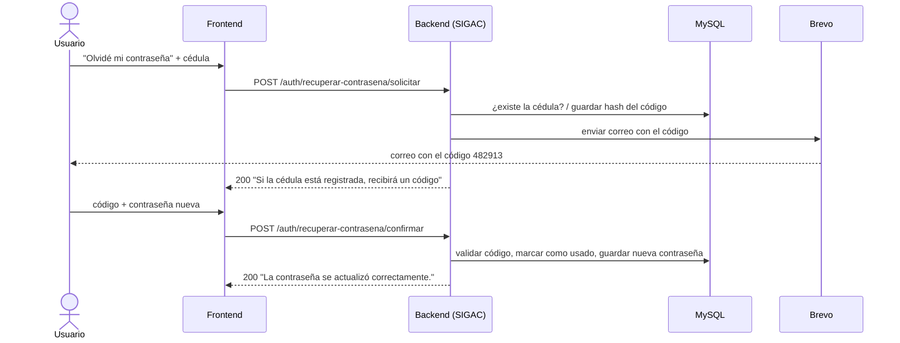

# Recuperación y cambio de contraseña con código por correo

Este documento explica, desde cero, cómo funciona en SIGAC la función de **"Olvidé mi contraseña"** y la de **cambiar la contraseña con sesión iniciada**. Las dos usan un **código de 6 dígitos** que se envía por correo.

---

## 1. La idea general

Piense en un banco:

1. Usted dice "olvidé mi clave".
2. El banco le manda un **código por SMS**.
3. Usted escribe ese código junto con la clave nueva.
4. El código **solo sirve una vez** y **vence** en unos minutos.

SIGAC hace lo mismo, pero el código llega por **correo electrónico**.

Hay dos flujos:

| Flujo | ¿Quién lo usa? | ¿Necesita sesión? |
|---|---|---|
| **Recuperar contraseña** | Alguien que olvidó su contraseña | No |
| **Cambiar contraseña** | Alguien que ya inició sesión y quiere cambiarla | Sí (JWT) |



---

## 2. Las piezas y quién hace qué

Cada pieza tiene **una sola responsabilidad**, como en una oficina:

| Pieza | Archivo | Analogía | Qué hace |
|---|---|---|---|
| Tabla | `sigac_db.sql` → `codigos_verificacion` | El talonario | Guarda los códigos emitidos |
| Entidad | `data/entity/CodigoVerificacion.java` | El molde del tiquete | Representa una fila de la tabla en Java |
| Repositorio | `data/repository/CodigoVerificacionRepository.java` | La ventanilla del archivo | Busca, cuenta y borra códigos |
| Servicio de códigos | `logic/service/CodigoVerificacionService.java` | El guarda del talonario | Genera y valida códigos |
| Servicio de correo | `logic/service/EmailService.java` | El cartero | Envía el correo con Brevo |
| Servicio de autenticación | `logic/service/AuthService.java` | El jefe de la oficina | Junta todo: busca el usuario, pide el código, manda el correo, cambia la contraseña |
| Controlador | `presentation/controller/AuthController.java` | Las ventanillas al público | Recibe las peticiones HTTP |
| DTOs | `presentation/dto/request/*.java` | Los formularios | Definen y validan el JSON que llega |
| Seguridad | `logic/security/SecurityConfig.java` | El portero | Decide qué rutas son públicas |
| Limpieza | `logic/service/LimpiezaCodigosVerificacionJob.java` | El conserje | Borra códigos viejos cada hora |

Todas las rutas Java de esta tabla empiezan en `backend/src/main/java/cr/acusab/una/sigac/`.

---

## 3. La base de datos: tabla `codigos_verificacion`

```sql
CREATE TABLE codigos_verificacion (
  id_codigo_verificacion BIGINT UNSIGNED  NOT NULL AUTO_INCREMENT,
  id_usuario             INT UNSIGNED     NOT NULL,
  proposito              VARCHAR(20)      NOT NULL,
  hash_codigo            VARCHAR(255)     NOT NULL,
  intentos               TINYINT UNSIGNED NOT NULL DEFAULT 0,
  expira_en              DATETIME         NOT NULL,
  usado_en               DATETIME,
  creado_en              DATETIME         NOT NULL DEFAULT CURRENT_TIMESTAMP,
  PRIMARY KEY (id_codigo_verificacion),
  INDEX idx_codigos_verificacion_usuario (id_usuario, proposito, creado_en),
  INDEX idx_codigos_verificacion_expira  (expira_en),
  CONSTRAINT fk_codigos_verificacion_usuarios FOREIGN KEY (id_usuario)
      REFERENCES usuarios (id_usuario) ON DELETE CASCADE,
  CONSTRAINT ck_codigos_verificacion_proposito CHECK (proposito IN ('RECUPERACION', 'CAMBIO'))
);
```

Cada fila es un "tiquete" del talonario:

| Columna | Para qué sirve |
|---|---|
| `id_usuario` | A quién pertenece el código. Un usuario puede tener muchos códigos a lo largo del tiempo. |
| `proposito` | `RECUPERACION` o `CAMBIO`. Un código de un tipo no sirve para el otro. |
| `hash_codigo` | El código **cifrado con BCrypt**, nunca el código real. Si alguien roba la base, no puede leerlos. |
| `intentos` | Cuántas veces se escribió mal. Al llegar a 5, el código queda inservible. |
| `expira_en` | Hasta cuándo vale (15 minutos después de crearlo). |
| `usado_en` | Vacío = sin usar. Con fecha = ya se usó y no vuelve a servir (como el sello de "PAGADO"). |
| `creado_en` | Para saber cuál es el más reciente y limitar reenvíos. |

- **`ON DELETE CASCADE`**: si se borra el usuario, sus códigos se borran solos.
- **Los índices** aceleran la búsqueda del último código de un usuario y la limpieza por fecha de vencimiento.

> ⚠️ El backend tiene `spring.jpa.hibernate.ddl-auto=none`: **Spring no crea tablas**. El `CREATE TABLE` hay que ejecutarlo a mano en MySQL, tanto en la base local como en la de Railway.

---

## 4. La entidad `CodigoVerificacion`

Es el "molde" que traduce una fila de la tabla a un objeto Java. Lo importante:

- **`@Entity` y `@Table(name = "codigos_verificacion")`**: conectan la clase con la tabla.
- **`enum Proposito { RECUPERACION, CAMBIO }`**: una lista cerrada de opciones, como los botones de un ascensor. Evita errores de escritura como `"Recuperacion"`.
- **`@Enumerated(EnumType.STRING)`**: guarda el **texto** (`"CAMBIO"`) en la columna y no la posición (`1`). Si no, el `CHECK` de la tabla lo rechazaría.
- **`@ManyToOne` con `Usuario`**: muchos códigos pertenecen a un usuario. Con `FetchType.LAZY`, el usuario solo se carga cuando se necesita.
- **`@PrePersist`**: justo antes de guardar, pone `intentos = 0` y `creadoEn = ahora` si vienen vacíos. Hace falta porque Hibernate envía todas las columnas en el `INSERT` y MySQL no aplicaría su `DEFAULT`.

---

## 5. El repositorio `CodigoVerificacionRepository`

Spring Data **lee el nombre del método y escribe el SQL** automáticamente:

```java
Optional<CodigoVerificacion> findFirstByIdUsuarioAndPropositoOrderByIdDesc(Usuario usuario, Proposito proposito);
long countByIdUsuarioAndPropositoAndCreadoEnAfter(Usuario usuario, Proposito proposito, Instant desde);
void deleteByExpiraEnBefore(Instant instante);
```

| Método | En español | Para qué |
|---|---|---|
| `findFirst...OrderByIdDesc` | "Dame el código **más reciente** de este usuario para este propósito" | Validar |
| `countBy...CreadoEnAfter` | "¿Cuántos códigos pidió desde tal hora?" | Limitar reenvíos |
| `deleteByExpiraEnBefore` | "Borra los que vencieron antes de tal fecha" | Limpieza |

**Decisiones importantes:**
- Se ordena por `id` y no por `creado_en`, porque `DATETIME` guarda solo hasta los segundos y dos códigos creados en el mismo segundo empatarían.
- **No se filtra por "no usado".** Siempre se toma el **último** código. Así, pedir uno nuevo anula los anteriores, como cambiar la cerradura: las llaves viejas ya no abren. Si se buscara "el último sin usar", después de usar el nuevo volvería a servir uno viejo.
- `Optional` es una "caja que puede venir vacía": evita los `NullPointerException`.

---

## 6. El servicio de códigos `CodigoVerificacionService`

### Las reglas (constantes)

| Regla | Valor |
|---|---|
| Vigencia del código | **15 minutos** |
| Intentos máximos por código | **5** |
| Espera entre envíos | **1 minuto** |
| Códigos por hora (por usuario y propósito) | **5** |

### `generar(usuario, proposito)`: entregar un código

1. **Revisa los límites de envío.** Si el usuario pidió un código hace menos de un minuto, o ya pidió 5 en la última hora, responde **429 Too Many Requests**. Esto evita que alguien llene de correos a otra persona y cuida los 300 correos diarios del plan gratis de Brevo.
2. **Genera el código** con `SecureRandom`, que no es predecible como el `Random` normal. `String.format("%06d", ...)` garantiza siempre 6 dígitos (por ejemplo `004821`).
3. **Guarda el hash BCrypt** del código, nunca el código real.
4. **Devuelve el código en texto plano**, solo para meterlo en el correo.

### `validar(usuario, proposito, codigo)`: revisar un código

1. Busca el **último** código. Si no hay ninguno, da error.
2. Si **ya se usó**, **venció** o **agotó los 5 intentos**, da error (sin siquiera comparar el código).
3. Compara el código escrito con el hash usando `passwordEncoder.matches(...)`. Es como comparar huellas: no se "descifra" el hash, se revisa si coincide.
4. Si **no coincide**, suma 1 a `intentos`, lo guarda y da error.
5. Si **coincide**, lo marca como usado (`usado_en = ahora`).

Todos los errores usan **el mismo mensaje**: *"El código no es válido o ya venció. Solicite uno nuevo."* Así no se le dan pistas a un atacante (por ejemplo, "te quedan 3 intentos").

### ⚠️ La trampa de las transacciones

```java
@Transactional(propagation = Propagation.REQUIRES_NEW, noRollbackFor = ResponseStatusException.class)
public void validar(...)
```

Normalmente, cuando un método `@Transactional` lanza un error, Spring **deshace todo** (rollback). Si el código está mal, sumamos 1 a `intentos` **y** lanzamos un error. Sin cuidado, el rollback **borraría ese +1** y el atacante tendría intentos infinitos. Es como si el guarda anotara cada fallo en una pizarra y la borrara cada vez que dice "incorrecto".

- **`noRollbackFor = ResponseStatusException.class`**: no deshace los cambios cuando el error es de este tipo.
- **`REQUIRES_NEW`**: corre en **su propia transacción**, separada de la de `AuthService`. Así, aunque `AuthService` haga rollback, el +1 ya quedó guardado. Es como si el guarda anotara en **su propia libreta**.

---

## 7. El servicio de correo `EmailService`

### ¿Por qué Brevo y por qué su API HTTP?

- **Railway bloquea SMTP saliente** (el protocolo clásico de correo) en los planes Free, Trial y Hobby. La **API HTTP** de Brevo funciona en cualquier plan.
- Plan gratis de Brevo: **300 correos al día**.
- Endpoint: `POST https://api.brevo.com/v3/smtp/email`, con la API key en el header `api-key`. Aunque la ruta diga `smtp`, es la API HTTP.
- Remitente: `noreply@acusab.ed.cr` (nombre `SIGAC ACUSAB`). Ese dominio no tiene buzón, así que **nadie recibe respuestas** en esa dirección.

### Cómo funciona

- Tiene dos métodos públicos: `enviarCodigoRecuperacion(...)` y `enviarCodigoCambio(...)`. Solo cambian el **asunto** y la **primera frase** del correo.
- El HTML del correo lleva los estilos **dentro de cada etiqueta**, porque Gmail y Outlook ignoran el CSS separado.
- Usa `RestClient` con **tiempos límite** (5 s para conectar y 10 s para leer). Así, si Brevo se cuelga, el backend no se queda esperando para siempre.
- Si Brevo responde con un error, se escribe el detalle en el log del backend y el usuario recibe un **503** genérico.

### Modo local (sin cuenta de Brevo)

Si `brevo.api-key` está **vacía**, **no se envía nada** y el código se muestra en la consola:

```
WARN ... EmailService : brevo.api-key vacía: no se envía el correo. Código para ana@correo.com: 004821 (vence en 15 min)
```

Así cualquier persona del equipo puede probar sin cuenta de Brevo. En producción (Railway) **siempre** debe estar configurada `BREVO_API_KEY`. Si no, los códigos quedarían escritos en los logs.

---

## 8. `AuthService`: el que junta todo

### Recuperar: paso 1, `solicitarCodigoRecuperacion(cedula)`

```java
usuarioRepository.findByCedula(cedula.trim()).ifPresent(usuario -> {
    try {
        String codigo = codigoVerificacionService.generar(usuario, Proposito.RECUPERACION);
        emailService.enviarCodigoRecuperacion(usuario.getCorreo(), codigo, MINUTOS_VIGENCIA);
    } catch (ResponseStatusException e) {
        log.warn(...);
    }
});
```

- Si la cédula **no existe**, no hace nada.
- Si algo falla (demasiados códigos, Brevo caído), **no se le avisa al usuario**. Solo queda en el log.

🔑 **Por qué:** si respondiéramos distinto según el caso, un atacante podría averiguar **qué cédulas tienen cuenta**. Por ejemplo, si el sexto intento con la cédula de una persona dijera "demasiados códigos", sabría que esa cuenta existe. Por eso la respuesta siempre es la misma.

### Recuperar: paso 2, `restablecerContrasena(request)`

1. Busca el usuario por cédula. Si no existe, responde el **mismo error** que un código incorrecto.
2. Valida el código (`validar`). Si falla, la ejecución se detiene ahí.
3. Guarda la nueva contraseña.

### Cambiar: paso 1, `solicitarCodigoCambio(cedula)`

El usuario ya inició sesión, así que se identifica por la **cédula del JWT**. Aquí **sí** se muestran los errores (429, 503), porque no hay nada que ocultar.

### Cambiar: paso 2, `cambiarContrasena(cedula, request)`

1. Valida **primero el código**.
2. Después verifica la **contraseña actual**.
3. Guarda la nueva.

🔑 **Por qué primero el código:** si alguien encuentra una sesión abierta y quiere adivinar la contraseña actual, cada intento le **gasta un código**. Los códigos están limitados a 5 por hora y llegan al correo del dueño, que se daría cuenta.

### Al guardar la nueva contraseña (`guardarNuevaContrasena`)

- Rechaza la contraseña si es **igual a la actual**.
- Guarda el **hash BCrypt** de la nueva.
- `requiere_cambio_contrasena = false`: si tenía una contraseña temporal, ya cumplió con cambiarla.
- `intentos_fallidos = 0` y `bloqueado_hasta = null`: si estaba bloqueado por equivocarse al iniciar sesión, se desbloquea, porque demostró ser el dueño del correo.

---

## 9. Los endpoints

Las rutas no llevan `/api`: ese prefijo lo agregan Vite y Nginx del lado del frontend.

### `POST /auth/recuperar-contrasena/solicitar` (público)

```json
{ "cedula": "1-2345-6789" }
```
Respuesta **siempre** `200`, exista o no la cédula:
```json
{ "message": "Si la cédula está registrada, recibirá un código en el correo de la cuenta en unos minutos." }
```

### `POST /auth/recuperar-contrasena/confirmar` (público)

```json
{ "cedula": "1-2345-6789", "codigo": "482913", "contrasenaNueva": "MiClave#Nueva26" }
```
- `200` → `{ "message": "La contraseña se actualizó correctamente." }`
- `400` → `{ "status": 400, "message": "El código no es válido o ya venció. Solicite uno nuevo." }`

### `POST /auth/cambiar-contrasena/solicitar` (requiere `Authorization: Bearer <token>`)

No lleva cuerpo. El usuario se toma del JWT.
- `200` → `{ "message": "Se envió un código a su correo." }`
- `429` → si pidió demasiados códigos.
- `503` → si no se pudo enviar el correo.

### `POST /auth/cambiar-contrasena/confirmar` (requiere `Authorization: Bearer <token>`)

```json
{ "contrasenaActual": "ClaveVieja2025", "contrasenaNueva": "MiClave#Nueva26", "codigo": "482913" }
```

### Reglas de validación de los formularios (DTOs)

| Campo | Regla |
|---|---|
| `cedula` | Obligatoria, máximo 20 caracteres (igual que en el login) |
| `codigo` | Exactamente 6 dígitos (`@Pattern(regexp = "\\d{6}")`) |
| `contrasenaNueva` | Entre **12 y 16** caracteres, con al menos **una mayúscula, un número y un carácter especial** (`PoliticaContrasena`) |

> ⚠️ **Por qué máximo 16:** `LoginRequest` solo acepta contraseñas de hasta 16 caracteres. Si se permitiera guardar una más larga, el usuario **no podría volver a iniciar sesión**.

`@Valid` en el controlador es lo que **activa** estas reglas. Sin `@Valid`, las anotaciones no hacen nada.

### Seguridad (`SecurityConfig`)

- `/auth/recuperar-contrasena/solicitar` y `/auth/recuperar-contrasena/confirmar` están en `permitAll()`, porque quien olvidó su contraseña no puede tener sesión.
- `/auth/cambiar-contrasena/...` **no** están ahí. Caen en `.anyRequest().authenticated()`: sin JWT válido, responden 401.

---

## 10. Limpieza automática `LimpiezaCodigosVerificacionJob`

```java
@Scheduled(fixedRate = 3600000) // cada hora
@Transactional
public void purgarVencidos() {
    codigoVerificacionRepository.deleteByExpiraEnBefore(Instant.now().minus(Duration.ofDays(1)));
}
```

Cada hora borra los códigos que **vencieron hace más de un día**.

**¿Por qué no borrarlos apenas vencen?** El límite de "5 códigos por hora" **cuenta los códigos de la última hora**. Si se borraran a los 15 minutos, el conteo nunca llegaría a 5 y el límite no funcionaría. Además, guardarlos un día ayuda a revisar casos de "no me llegó el código".

---

## 11. Configuración

### `backend/src/main/resources/application.properties`

```properties
brevo.api-key=${BREVO_API_KEY:}
brevo.sender-email=${BREVO_SENDER_EMAIL:noreply@acusab.ed.cr}
brevo.sender-name=${BREVO_SENDER_NAME:SIGAC ACUSAB}
```
`${VARIABLE:valor}` significa "usa la variable de entorno; si no existe, usa el valor por defecto".

### `backend/src/test/resources/application.properties`

```properties
brevo.api-key=
brevo.sender-email=test@acusab.ed.cr
brevo.sender-name=SIGAC Test
```
La llave está vacía a propósito: las pruebas **nunca** envían correos reales.

### Variables de entorno

| Variable | Requerida | Valor por defecto |
|---|---|---|
| `BREVO_API_KEY` | En producción, sí | (vacía → modo local) |
| `BREVO_SENDER_EMAIL` | No | `noreply@acusab.ed.cr` |
| `BREVO_SENDER_NAME` | No | `SIGAC ACUSAB` |

> 🔒 La API key es **secreta**: nunca va en el código ni en Git, solo en las variables de Railway.

---

## 12. Puesta en marcha en Brevo y Railway

Ya hecho:
- Cuenta de Brevo creada.
- Dominio `acusab.ed.cr` autenticado en Brevo. Los DNS están en NIC.cr y se agregaron el TXT `brevo-code`, los CNAME `brevo1/brevo2._domainkey` y el TXT `_dmarc`.

Pendiente:
1. Crear el remitente `noreply@acusab.ed.cr` en Brevo (**Senders**).
2. Generar la API key (**SMTP & API → API Keys**).
3. En Railway (servicio backend): agregar la variable `BREVO_API_KEY`.
4. Ejecutar el `CREATE TABLE codigos_verificacion` en la base de Railway.
5. Si Brevo responde **401 "unrecognised IP address"**, desactivar la restricción de IPs autorizadas en Brevo. Railway no tiene una IP fija.

---

## 13. Cómo probarlo en local

1. Ejecute el `CREATE TABLE codigos_verificacion` en su MySQL local.
2. Arranque el backend **sin** `BREVO_API_KEY`.
3. Pida un código, cambiando la cédula por la de un usuario existente:
   ```powershell
   curl.exe -X POST http://localhost:8080/auth/recuperar-contrasena/solicitar -H "Content-Type: application/json" -d '{\"cedula\":\"1-2345-6789\"}'
   ```
4. Busque el código en la consola del backend (línea `WARN ... EmailService`).
5. Confírmelo:
   ```powershell
   curl.exe -X POST http://localhost:8080/auth/recuperar-contrasena/confirmar -H "Content-Type: application/json" -d '{\"cedula\":\"1-2345-6789\",\"codigo\":\"123456\",\"contrasenaNueva\":\"MiClave#Nueva26\"}'
   ```
6. Inicie sesión con la contraseña nueva.

**Casos para probar que la seguridad funciona:**
- Pedir dos códigos seguidos: el segundo **no** se envía (espera de 1 minuto).
- Escribir mal el código 5 veces: el sexto intento falla **aunque el código sea correcto**.
- Usar el mismo código dos veces: la segunda vez falla.
- Pedir un código nuevo e intentar usar el anterior: falla.
- Pedir un código para una cédula que no existe: la respuesta es **igual** que para una que existe.

---

## 14. Limitaciones conocidas

- **Las sesiones abiertas no se cierran** al cambiar la contraseña: los JWT viejos siguen sirviendo hasta que vencen (1 hora).
- Si el usuario escribe como nueva la **misma contraseña** que tenía, el código ya quedó gastado y tiene que pedir otro.
- Si Brevo falla en la recuperación, el usuario no se entera (para no revelar si la cuenta existe). El error solo queda en el log.
- El frontend de "Olvidé mi contraseña" está en `frontend/src/pages/Publico/RecuperarContrasena.jsx` (ruta `/recuperar-contrasena`, con enlace desde el login). Falta la pantalla de **"Cambiar contraseña"** con sesión iniciada.
- En el frontend, el paso 2 ("Ingrese su código") solo revisa que sean 6 dígitos: el backend no tiene un endpoint para "solo verificar" el código, así que se comprueba al guardar la contraseña en el paso 3. Si falla, la pantalla vuelve al paso 2.
- La regla de composición (mayúscula, número y carácter especial) está en dos lugares que deben coincidir: `PoliticaContrasena.java` (backend) y `REQUISITOS` en `RecuperarContrasena.jsx` (frontend).
